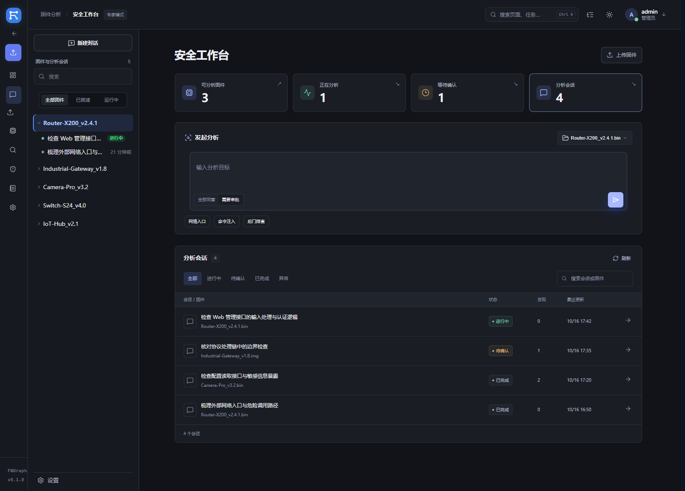
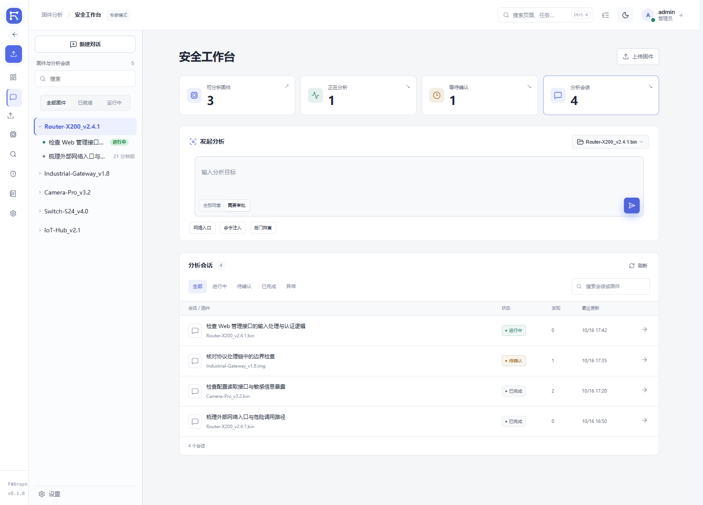
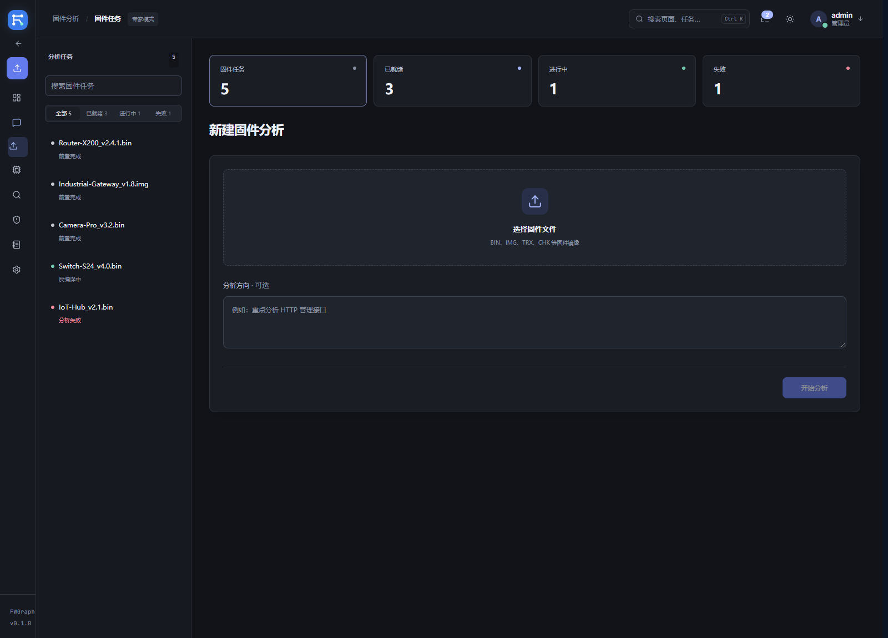
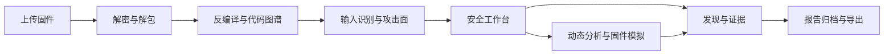

# FWGraph

固件攻击面分析平台，将固件处理、代码分析、漏洞挖掘、模拟验证与报告归档放在同一个工作区。

[](LICENSE)
[使用流程](#使用流程) · [部署](#部署) · [验证](#验证) · [文档](#文档)



> 界面预览使用演示数据。面向桌面浏览器，支持深色和浅色主题。

## 工作区

| 模块 | 主要操作 |
| --- | --- |
| 安全工作台 | 查看分析概览，按状态筛选、搜索及分页浏览会话，选择固件发起分析，查看执行记录与调用证据 |
| 固件任务 | 上传固件，跟踪解密、解包、反编译与图谱构建，筛选失败任务，查看失败原因并重试支持的阶段 |
| 输入面 | 按服务、协议或端口筛选输入，查看入口、分发链、授权链及攻击面证据 |
| 代码分析 | 检索函数与伪代码，检查攻击路径、调用图、CFG 与 AST |
| 固件工具 | 固件解密、后门检测、入口风险评估、协议模糊测试、固件模拟与事件流 |
| 漏洞库与报告 | 归档发现和证据，预览报告，按风险统计并导出 DOCX、PDF、Markdown |
| 平台管理 | 用户与权限、日志审计、模型连接和系统设置 |
| 仪表盘 | 汇总运行状态、分析进度与风险分布 |

<details>
<summary>浅色工作台与固件任务</summary>





</details>

## 使用流程

1. 在「固件任务」上传固件，可填写分析方向，等待前置分析完成。
2. 在「安全工作台」选择已就绪固件，输入目标或选择常用分析方向。
3. 在输入面、函数、攻击面和图谱中核对证据；在会话中查看工具调用、审批和执行状态。
4. 需要动态验证时，在「固件模拟」查看环境、服务探测与验证记录。
5. 在「漏洞库」复核发现，在「报告中心」预览和导出结果。

工作台概览与筛选均来自真实任务、会话状态；未进行动态验证的静态证据保留对应标记。

## 分析能力

- **固件处理**：EMBA 解包、ELF 清单与 checksec；支持 mips、arm、x86、ppc、riscv ELF，以及部分 PX4、ARM Cortex-M 镜像。
- **反编译与图谱**：IDA Pro 无头反编译，按二进制 MD5 复用产物；CBM 调用图、函数 CFG、伪代码 AST；可选 FLIRT / Lumina 命名恢复。
- **输入与攻击面**：识别服务、协议、端口、输入类型和处理链；逐输入导出路由、载体绑定、handler 与独立授权链，记录证据等级和排除项。
- **漏洞挖掘**：工作台通过 DeepSeek Harness 调用平台工具，关联函数、调用链、PoC 与发现；支持审批、续跑、会话归档和导出。
- **动态分析**：qemu-user 覆盖率差分与单次 PoC 执行，AFL++、frida hook、协议模糊测试；独立 emulagent 管理固件模拟环境和服务验证。
- **结果管理**：发现分级、风险统计、报告预览及 DOCX / PDF / Markdown 导出。
- **访问控制**：账号登录、首登改密、会话令牌、owner 数据隔离、管理员权限、配额与审计。



## 部署

### 环境要求

| 依赖 | 用途 |
| --- | --- |
| Linux、Python 3.11+ | 编排服务；已在 Ubuntu 26.04 / Python 3.14 环境验证 |
| Node.js 22.12+、npm | Web UI 构建；挖掘引擎还需要 pnpm |
| Docker、EMBA | 固件解包与分析沙箱 |
| IDA Pro 9.1、Hex-Rays | 无头反编译，需自行安装与配置许可 |
| codebase-memory-mcp | 图谱索引与查询 |
| qemu-user / AFL++ / frida | 按需启用的动态分析能力 |
| 模型 API | 挖掘与模拟代理使用的模型连接 |
| LibreOffice Writer | PDF 报告导出，可选 |

### 从源码运行

```bash
git clone https://github.com/tangjunyi23/firmware-code-graph-platform.git
cd firmware-code-graph-platform

# Python 环境与图谱工具；系统依赖按 setup.sh 提示安装
(cd fwgraph && bash setup.sh)
cp fwgraph/.env.example fwgraph/.env
```

编辑 `fwgraph/.env`，配置 `ORCH_TOKEN`、IDA、EMBA 与模型连接等参数；EMBA 需独立安装，安装步骤见其官方文档。可通过 `ADMIN_INITIAL_PASSWORD` 配置初始管理员密码。实际凭据与机器配置保留在部署环境中。

```bash
# 构建前端，生成由编排服务托管的 webui/dist
(cd fwgraph/webui && npm ci && npm run build)

# 安装挖掘引擎，配置 vulnagent 的服务地址、令牌和模型连接
bash vulnagent/dsh/setup.sh
cp vulnagent/.env.example vulnagent/.env

# 显式指定项目位置，避免启动脚本沿用旧的默认目录
FWGRAPH_ROOT="$PWD/fwgraph" bash fwgraph/scripts/run_orchestrator.sh
```

打开 `https://<host>:8000/`。服务默认启用 TLS；使用 `ORCH_SSL=0` 时访问 HTTP。管理员首次使用默认密码登录后需修改密码。已有 `fwgraph.service` 的部署可使用 `systemctl --user start fwgraph.service`，具体服务路径以本机配置为准。

前端开发服务：

```bash
cd fwgraph/webui
npm ci
npm run dev
```

完整配置见 [部署运维手册](fwgraph/README.md) 和 [部署说明](DEPLOY.md)。

### Docker Compose

```bash
docker compose -f deploy/docker/docker-compose.yml --profile build build
docker compose -f deploy/docker/docker-compose.yml up -d
```

IDA、图谱工具和沙箱资源需要按部署方式准备。卷、证书与依赖配置见 [Docker 部署手册](deploy/docker/README.md)；离线迁移见 [迁移部署说明](deploy/migrate/DEPLOY.md)。

## 验证

最近验证：**2026-10-16**。

| 检查 | 结果 |
| --- | --- |
| 编排服务测试 | 630 通过，1 跳过，4 个既有弃用警告 |
| 工作台会话回归 | 4 通过 |
| 前端生产构建 | 通过；保留现有大体积 chunk 提示 |
| 桌面浏览器 | 1366、1440、1920 宽度；深浅主题与主要操作通过 |
| 仪表盘回归 | 13 个区域的位置与尺寸差异为 0；主体源文件校验一致 |

```bash
# 在仓库根目录
(cd fwgraph && .venv/bin/python -m pytest orchestrator/tests -q)
(cd fwgraph/webui && npm run test:session && npm run build)
```

本轮工作台筛选、分页、会话打开、固件绑定和上传控件验证未提交真实分析任务。详细记录见 [界面设计与验收](docs/ui-design.md)。

## 能力边界

- 固件模拟受 CPU 架构、内核、MTD / NVRAM、设备节点与驱动依赖影响，部分设备需要适配。
- 网络 trace 可能得到空差分；部分 MIPS 函数级 AFL handshake 不稳定，可按场景使用整二进制模式。
- 静态发现与动态验证分别记录。连接成功、启动崩溃和空差分不作为漏洞确认。
- 原始反编译产物、IDB 与证据不被界面改名或覆盖；静态证据保留来源与置信度。
- 仓库包含历史会话与示例发现。固件、解包文件系统、IDA 数据库、图谱和模拟工作区保留在分析机，克隆源码后需配置环境并重新分析。

## 项目结构

```text
fwgraph/
  orchestrator/       API、账号、编排、报告及模拟接口
  pipeline/           固件处理、反编译、图谱、攻击面与动态分析
  webui/              Vue 3、Element Plus、ECharts 桌面界面
  config/             分析规则与命名配置
  scripts/            启动和回归脚本
vulnagent/
  dsh/                Harness profile、工具与分析 skill
  sessions/           历史分析会话
  findings/           已归档发现
deploy/               Docker 与迁移部署
docs/                 界面设计记录与演示截图
```

## 文档

- [项目进度](进度-项目.md) · [前端进度](进度-前端.md) · [后端进度](进度-后端.md)
- [部署运维](fwgraph/README.md) · [Docker 部署](deploy/docker/README.md)
- [vulnagent](vulnagent/README.md) · [IDA 工具](tools/ida-no-mcp/rootfs_elf/README.md)
- [界面设计与验收](docs/ui-design.md) · [交接记录](HANDOFF.md)

## 许可

[Apache License 2.0](LICENSE)
